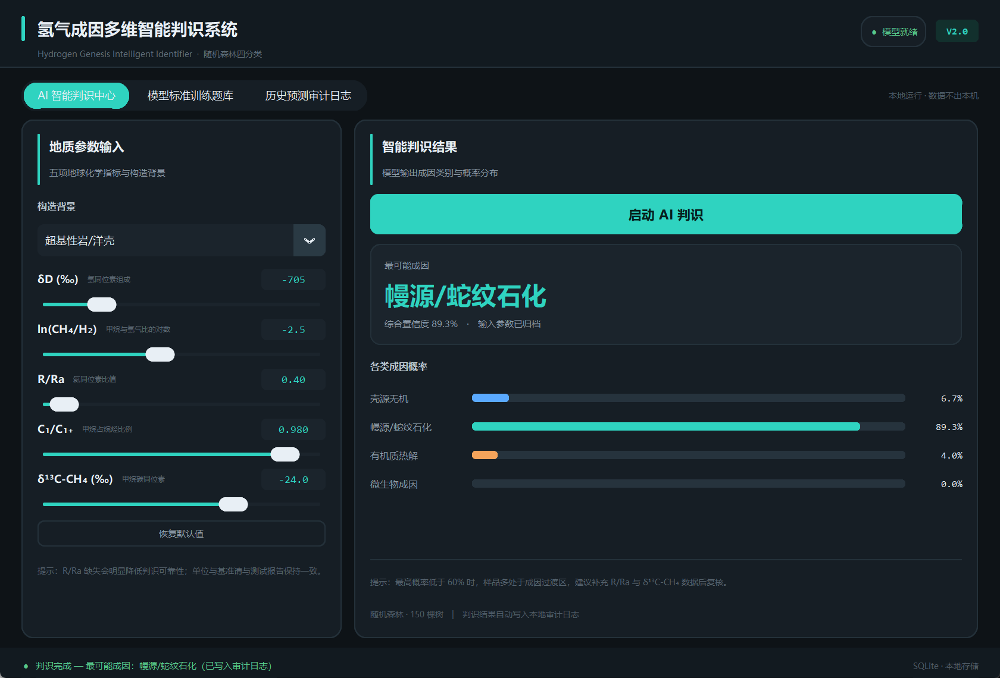
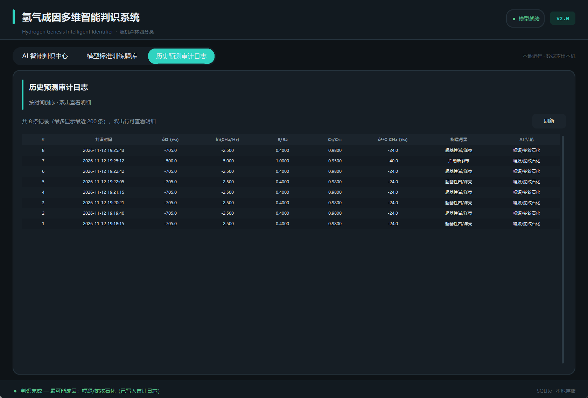

# 氢气成因多维智能判识系统 V2.0

Hydrogen Genesis Multi-Dimensional Intelligent Identifier

基于随机森林的天然氢气成因判识桌面软件。输入五项地球化学指标与构造背景，输出成因类型与概率分布，并把每一次判识写入本地审计日志。



## 功能

- **智能判识**：随机森林四分类（壳源无机 / 幔源·蛇纹石化 / 有机质热解 / 微生物成因），输出概率分布，单次约 25 ms
- **训练题库**：内置 2000 条标准样本，四类各 500 条，含参数重叠区，可浏览检索
- **审计日志**：判识记录写入本地 SQLite，按时间倒序查看，双击查看明细
- **模型管理**：支持重新训练、九种算法横向对比
- **离线运行**：不联网、不上传数据，历史记录保存在 `%LOCALAPPDATA%\HydrogenSystem\`



## 快速开始

```bash
pip install -r requirements.txt
python train_model.py      # 可选：重新训练模型
python main_app.py         # 启动软件
```

也可直接下载 [Releases](https://github.com/20060117hzj-prog/hydrogen/releases) 中的免安装版本，解压后双击 exe 运行，无需 Python 环境。

## 项目结构

```
hydrogen/
├── main_app.py              # 桌面界面与判识逻辑
├── db_manager.py            # SQLite 数据访问层
├── train_model.py           # 随机森林训练
├── compare_models.py        # 九种模型对比
├── build_dataset.py         # 合成数据集构建
├── extract_real_data.py     # 文献数据提取
├── hydrogen_model.pkl       # 训练好的模型（发布版附带）
├── hydrogen_realistic_dataset.csv   # 默认训练集（2000 条）
├── tests/                   # 单元测试
└── docs/                    # 界面截图
```

## 数据说明

训练样本依据公开文献给出的地球化学判别区间构建，并在类别之间保留重叠区，用于模拟真实样品的模糊边界。真实文献样品 102 条，其中 R/Ra 缺失率 100%、δ¹³C-CH₄ 缺失 87%、δD 缺失 81%，因此模型指标仅在合成数据上具有意义，**不能直接外推为真实样品的判识精度**。

内置样本用于模型训练与功能演示，不作为地质结论的直接证据。

## 版本记录

| 版本 | 日期 | 说明 |
|---|---|---|
| V2.0 | 2026-11 | 界面重构（三页式布局、概率条、状态栏）；修复打包后判识记录丢失；修复滚动条回调异常；预测改为单线程；修正数据缺失提示文案 |
| V1.0 | 2026-05 | 首版：数据生成、模型训练与基础判识流程 |

## 已知局限

- 训练数据以合成样本为主，真实样品占比不足 5%
- R/Ra 在真实样品中普遍缺失，而它恰是区分壳源与幔源的关键指标
- 参数输入目前通过滑块完成，精度受步长限制（后续版本将支持数值输入与批量导入）

## 版权

Copyright © 2026 洪志杰。本项目为长江大学大学生创新训练计划项目成果，仅供学术研究使用。
